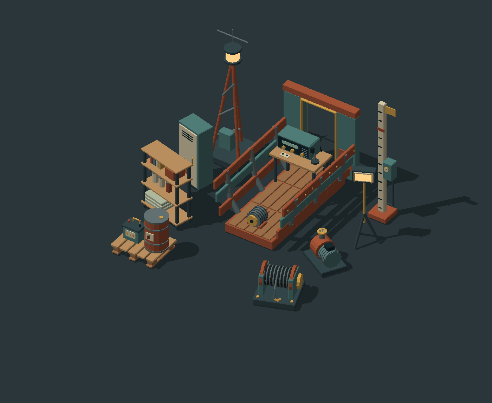

# Low Tide 3D

A separate 3D crawler experiment for Sindri. The isometric POC now renders the
committed Astra cutaway GLB as an external model asset in native and WebGPU
Sindri runtimes.

See [the proof, limitations and reproduction commands](docs/POC.md). Requires
[engine PR #507](https://github.com/vardirhq/sindri-engine/pull/507) (the 3D
update), pinned in `.github/workflows/pages.yml`.

## Playing

The Keeper drives standing at the crawler's helm and turns with it; arrow keys
drive. **F** leaves the helm. On foot, **WASD** walks relative to the camera
and **Space** jumps. Walk the deck, out through the rear doorway and down the
ramp. **E** picks up the alternator by the station and installs it at the
crawler. Back at the helm, **F** takes it again. Hold the right mouse button
to orbit the camera.

### The first delivery

Low Tide is heading toward a courier game: you move cargo between stations
across a hostile, tidal seabed, and the crawler is your hauler and home. The
first delivery runs once the engine is repaired:

1. **Answer the radio** at the signal station (**ACCEPT**). The tide starts
   rising, and a timer shows under the objective.
2. **Fetch the battery pack** from the wreck in the north-west hollow, which
   floods first (**PICK UP**). It rides on the Keeper's back and slows them down.
3. **Haul it.** Carry it on foot, or put it on the crawler's rear deck
   (**LOAD** / **UNLOAD** at the cargo bay) and drive. Wading through deep
   water wears it down, and so do hard landings. On the deck it stays dry.
4. **Deliver it** to the beacon (**DELIVER**) to light the signal. The HUD
   reports the cargo's condition. If the tide reaches its peak first, the
   route floods and the order fails. The water drains and the order reopens.

Orders are data on their scene entity (cargo, destination, tide time).
`scripts/courier.decay` holds the `Order` and `Cargo` scripts.

On a phone, the screen is split. The **left half** is a floating stick that
drives the crawler or walks the Keeper, and the **right half** turns the
camera. The buttons appear only when they apply:
- **LEAVE HELM / TAKE HELM** at the helm.
- **JUMP** on foot.
- **PICK UP / INSTALL** beside the alternator and back at the crawler.
- The crawler's module toggles and **RESET** at the helm.

A line at the top says what to do next. `scripts/hud.decay` pins every control
to the screen edges for any shape or orientation.

On foot the Keeper is a physics character (PR #507's 3D character
controller). It stands on the imported seabed and is blocked by the salvage
props, which use their own GLBs as model colliders. The camera also pulls in
against them. `tests/headless/low_tide_plays.rs` plays this loop headless on
the engine in CI.

## 3D assets

The [Last Signal salvage pack](art/salvage/README.md) adds 14 reusable GLB
models: radio and tide equipment, recoverable machinery, storage and modular
wreck pieces. It includes editable source, sockets, collision proposals, a
combined diorama and a separate `salvage-catalog.scene` for inspection.

The [Keeper character](art/characters/keeper/README.md) includes a static
player mesh and a separate 17-joint rigged GLB with five animation clips. The
rigged version awaits Sindri's skeletal-animation pipeline; neither version
is wired into the playable scene yet.
