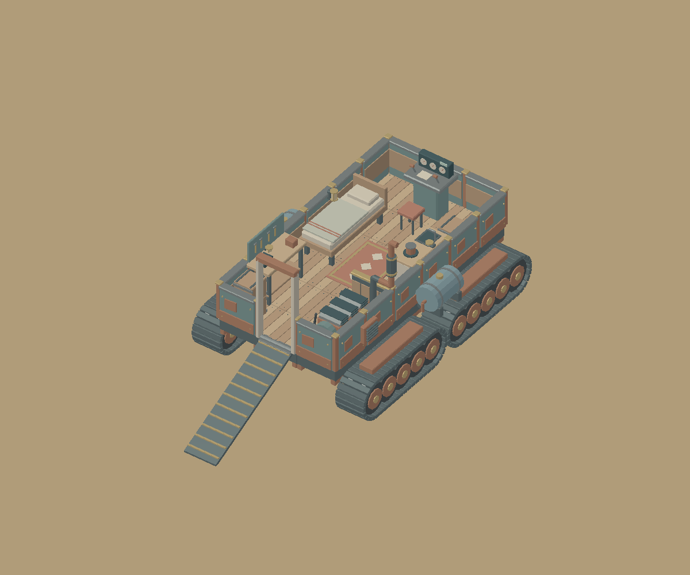
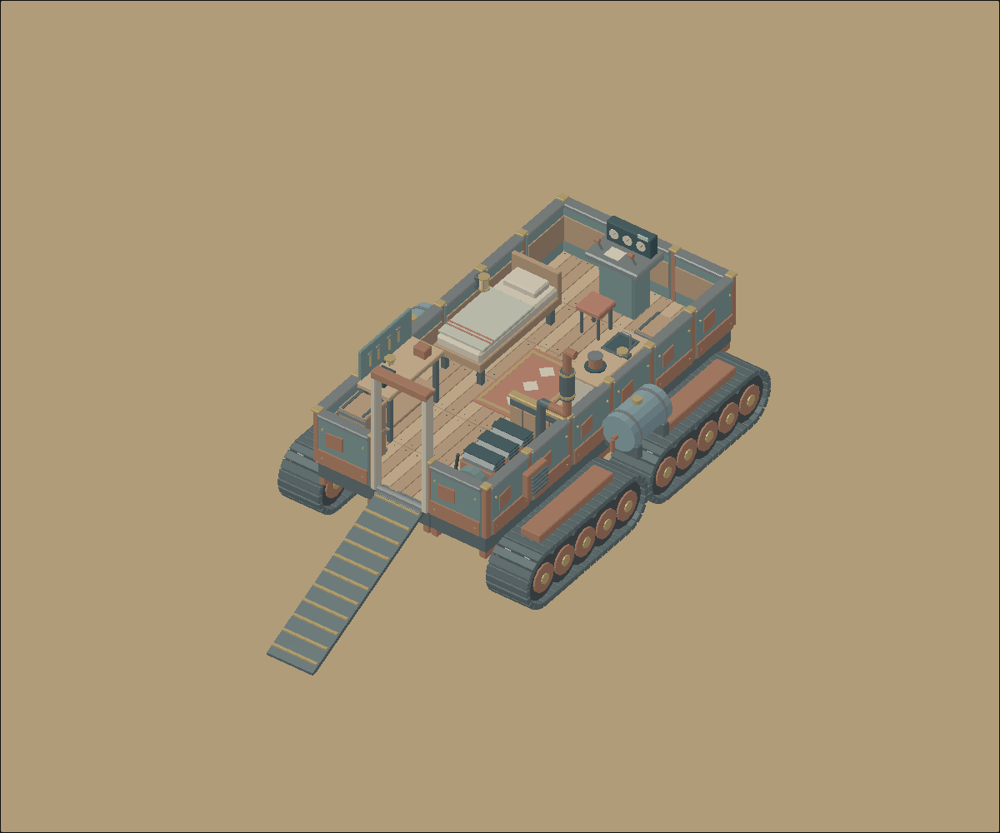

# Low Tide 3D: crawler rendering proof

The actual committed `Low_Tide_Kit/starter_crawler_cutaway.glb` renders in
Sindri's native offscreen project runtime and in the exported WebGPU browser
runtime. Both 1200 × 1000 captures were visually inspected on 2026-10-09.
Tracks, ramp, wood deck, bed, furniture and cabin are recognizable, correctly
oriented and colored. This is the external model, with normal depth-tested
geometry, rather than a baked preview or generated replacement.





## Engine requirement

Use **Sindri main**. Imported GLB support from [engine PR #504](https://github.com/vardirhq/sindri-engine/pull/504) has been merged.

`poc.scene` uses the general `sindri.model` component:

```json
{ "sindri.model": { "asset": "Low_Tide_Kit/starter_crawler_cutaway.glb", "layer": 1 } }
```

The model remains an external asset at its original location. Its SHA-256 is
`de9a1ec5d3d99cd8e2ca47ebe7e48d9fb202ccd4fddd09be85b6ea4818730ec2`.
The decoded model contains 177 nodes, 19 meshes, 85 primitives and 16 materials;
this particular model has no base-color textures. The engine's deterministic
fixture separately exercises embedded textures, multiple materials, both index
widths and reuse.

The export carried exactly three assets: the scene, the unchanged 888,192-byte
GLB and `textures/seabed.png`. Its manifest labels the GLB as `model`, verifies
its hash and places it in the normal content-hashed asset directory. Browser
smoke passed with WebGPU, a 1200 × 1000 canvas, loading screen completion and
real HTTP requests for all three asset kinds.

## Composition

The scene contains the crawler at identity transform, a flat solid-color seabed,
an orthographic three-quarter camera with vertical size 12, ambient light and a
warm directional sun. The original construction kit used Z-up, but the GLB is
already Y-up. No extra axis conversion is applied. Node names, hierarchy and
local transforms remain in the imported resource for future independent parts.

Imported-model shadows are not supported by this initial engine path and are
disabled. Skinning, animation, morphs, glTF lights/cameras and model authoring UI
are deferred. The kit's optional `KHR_lights_punctual` extension is reported as
ignored; the scene's Sindri light supplies lighting.

## Reproduce

From the engine checkout, replace `../low-tide-3d` if the repositories are not
siblings:

```bash
cargo run -p sindri-causeway --bin project-capture -- \
  ../low-tide-3d ../low-tide-3d/docs/proof/crawler-native.png 1200 1000
cargo run -p sindri-export --bin sindri-export -- \
  ../low-tide-3d target/low-tide-web --base /
cargo build -p sindri-player --lib --target wasm32-unknown-unknown
wasm-bindgen target/wasm32-unknown-unknown/debug/sindri_player.wasm \
  --target web --out-dir target/low-tide-web/pkg --out-name sindri_player
cd scripts/browser
npm ci
cd ../..
SINDRI_EXPECT_ASSETS=1 SINDRI_EXPECT_ASSET_KINDS=scene,model,texture \
SINDRI_VIEWPORT_WIDTH=1200 SINDRI_VIEWPORT_HEIGHT=1000 \
node scripts/browser/smoke.mjs target/low-tide-web \
  ../low-tide-3d/docs/proof/crawler-browser.png
```

Install the repo's Rust toolchain/WASM target and a `wasm-bindgen` CLI version
matching `Cargo.lock`. The inspected browser proof used Chrome headless shell
155 with software Vulkan. Set `CHROME_PATH` when supplying a browser executable.
The native proof used software Vulkan too; the capture is a real native GPU
render, not a native interactive player window.

This milestone introduces no tides, crafting, construction, diving, UI,
character movement or driving. No gameplay expansion has started.

## The Last Signal environment pass (in progress)

The scene now adds an abandoned signal-station silhouette, a mast, salvaged crates, discarded industrial parts and low salt banks around the original crawler. These use the kit's **actual individual GLB modules** and ordinary Sindri cube geometry; no engine edits or fake rendered image are involved. This is an initial composition pass, **not yet visually verified**. The scene remains static, with no crew or driving.

A GitHub Actions workflow at `.github/workflows/pages.yml` exports the external project with Sindri main, builds `sindri-player` for WASM, generates browser bindings and uploads a preview artifact. On merge to main it attempts GitHub Pages deployment to `/low-tide-3d/`. This workflow is new and its first CI run must be inspected before declaring web deployment functional.

The current environment pieces deliberately reuse the kit's modular assets. Next pass should inspect the actual browser screenshot for clipping, framing, overdraw and module origins, then refine lighting/composition and replace the simple station blockout with authored geometry. No shadows from imported models yet.

## Sindri PR #507 adoption

CI pins engine PR #507 (`7b48017`) and plays the scene headless before
exporting it. The Decay scripts pass `decay-lsp --check` against that engine,
and `tests/headless/low_tide_plays.rs` runs in the engine's own runtime, with
keyboard input delivered as a host would:

- The crawler drives, and the Keeper rides beside it.
- The Keeper steps off, settles onto the imported seabed and jumps.
- The salvage crates block the Keeper, and the controller reports the hit.
- The Keeper recovers the alternator by the station and installs it in the crawler.
- The Keeper boards again.

Removing the crate or seabed colliders makes the test fail.

What changed:

- **Character:** the Keeper (`art/characters/keeper/keeper_static.glb`)
  replaces the locker proxy. It uses the manifest's proposed capsule (1.87 m
  tall, 0.24 m radius) and `sindri.physics3d.character`.
- **Movement:** walking is camera-relative. Gravity, jumping and landing are
  Decay gameplay, and the engine clips the movement.
- **Colliders:** the seabed and the grounded salvage props carry
  `sindri.physics3d.model_collider` built from their own GLBs. The roof
  modules, the moving crawler and its equipment are render-only for now.
- **Asset root:** the art packs moved from `assets/` to `art/`. Sindri treats a
  project's `assets/` directory, when present, as its asset root. Low Tide keeps
  its scenes at the project root, so the old name made the engine look for
  `assets/poc.scene`.

Still open: the crawler has no collider (the Keeper rides beside it rather than
walking its deck), the rigged Keeper waits on skeletal animation, and browser
and mobile appearance have not been visually inspected for this pass.
